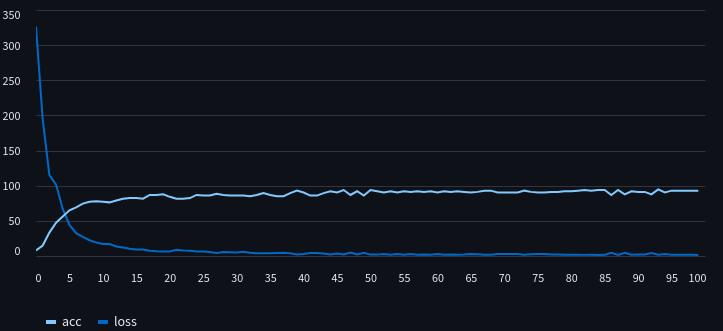

# Brest cancer with SVM

In this project I have applied SVM from scratch in [Brest cancer](https://www.kaggle.com/datasets/ahmedesso/brest-cancer) dataset in kaggle. This markdown is jus the preview of the project and how I made this. I have given more details in my [notes](https://github.com/gitbhusalhubpramish/ml-notes/tree/main/0.006%20SVM)about SVM.

THis is the loss accuracy graph of the algorithm in each epch(training loop). You can see the web preview through this [link](https://svm-brest-cancer.streamlit.app/).

## Small intro to SVM

SVM is a supervised regression bahsed classification meachine learning model which uses support vectors and decision line to classify data. The decision line shaprate the data into two parts.

## Feature

This project was made by me to understand SVM from scratch so it has SVM applied from scratch on the dataset. But also:

- SVM from scratch
- diagnosis for brest cancer

## Tech-Stack

This project uses python liberies used for data science - Visulization, calculation and data manipulation. I've used:

- Numpy for calculation
- Streamlit for data visulization and preview
- Pandas for data manipulation
- sk-learn for accuracy calculation and datasplit.

## Work-flow

The work flow of the project looks like this:

- **Fetch data:** Here the data is fetched from kaggle dataset.
- **Data shepration:** Here the algorithm sheprate the data into 2(4) parts for training and test for each with x and y.
- **Parameter initlization:** Here the model's parameter is initlized random
- **Training:** Here the greadient is calculated and the parameter are updated accordingly by greadient decent:

$$
w = w - \eta \frac{\partial L}{\partial w}
$$

- **Loss calculation:** This is done just to see how model is learning the graph in the preview is teh loss and accuracy graph for each step(epoh).
- **repeat:** repeat to train and calcuate error multiple times(epoch)

## So, What did I learn?

I had made this project to learn SVM form scratch. Of cource I had learnt this:) but other stuff like:

- SVM
- Hudge loss
- calcus
- data visulizaton and plotting

## Some extra info...

I have been learning Meachine Learning from scratch so I make notes and make at least one project for each. I have writtern a jupiter notebook to plan andmake this work then I make a python script file with the help of streamlit so that I can host and support hackclub. Most of the progress of learning the algorithm is in my notebook(coding time only) while I struggle a lot to research too. I made this to learn so it has very less AI implimented.
